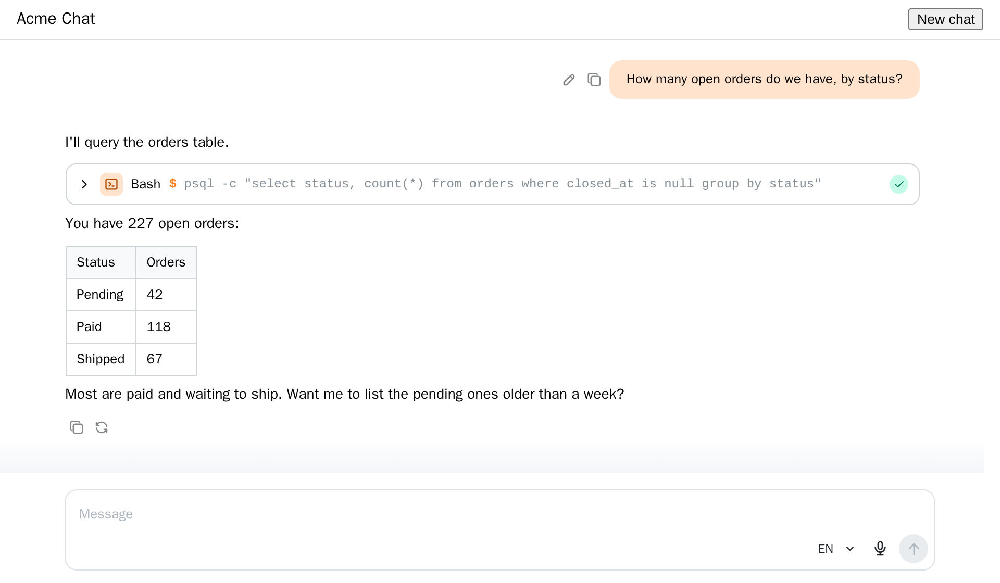

# runyard SDKs

Clients for [runyard](https://runyard.ai)'s agents API, in Go and TypeScript:
start sessions, talk to them, follow what they do.

## Add a chat to your web app



[`examples/`](examples) is that page, with its backend in
[Node](examples/node/server.js) or [Go](examples/go/main.go). Each is one
short file: your backend runs the **relay**, which holds your runyard key and
lets each signed-in person reach only their own sessions; the page draws the
chat with `@runyard-ai/runyard-react`. Start there.

## Install

| | |
|---|---|
| Go | `go get github.com/runyard-ai/runyard-sdk/go` |
| TypeScript | `npm install @runyard-ai/runyard-sdk` |

The npm packages are in runyard's registry, which needs no key. Add it to
`.npmrc`:

```ini
@runyard-ai:registry=https://releases.runyard.ai/npm/runyard-public/
```

Every call needs an API key (`ryak_…`), made in the console.

## More

- [Go SDK](go/README.md) and [TypeScript SDK](typescript/README.md)
- The API: [`openapi/agents.yaml`](openapi/agents.yaml)

SDK `vX.Y.Z` is the client of server `vX.Y.Z`. This repository is generated
from runyard-agents at each release. Report issues here.
