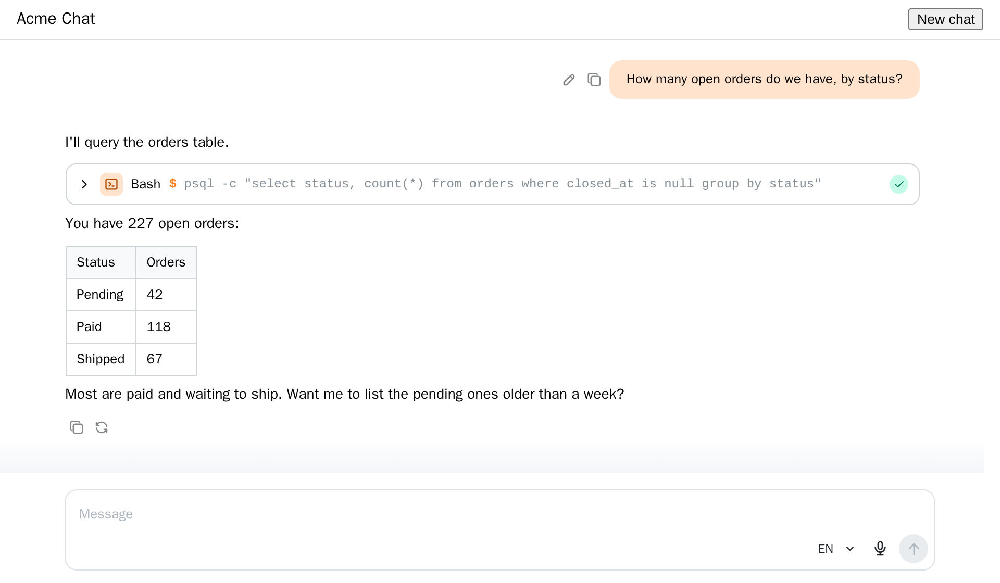

# Examples: a chat in your web app

A web page with a chat box, served by your backend. The same page is served by
a Node backend or a Go backend; pick one.



```
web/    the page: React, with @runyard-ai/runyard-react's Conversation and Composer
node/   the backend in Node: the relay and the page (server.js)
go/     the backend in Go: the relay and the page (main.go)
```

The backend holds your runyard key and runs the **relay**, which serves
runyard's API to the browser at `/agents`, limited to the signed-in person's
own sessions. The page talks only to the relay, never to runyard.

## Run it

You need a runyard server, a key with `sessions.read`, `sessions.write` and
`sessions.person`, and the email of a person in its workspace.

```sh
# 1. Build the page.
cd web && npm install && npm run build && cd ..

# 2. Run a backend.
export RUNYARD_URL=https://agents.example.com
export RUNYARD_KEY=ryak_…
export RUNYARD_PERSON=ada@example.com   # stands in for your sign-in

cd node && npm install && npm start     # Node
cd go && go run .                       # or Go
```

Open http://localhost:3000. `RUNYARD_PROFILE`, when set, is the profile
sessions are started from; the workspace's default otherwise.

To work on the page, keep a backend running and run `npm run dev` in `web/`:
Vite serves the page and sends `/agents` to the backend.

## What to read

- [`node/server.js`](node/server.js) or [`go/main.go`](go/main.go): the
  relay's three hooks, which are your integration:
  - `person`: who is asking. Replace the example's fixed person with your own
    sign-in.
  - `scope`: which sessions they reach. Here, their own, labelled
    `app: acme-chat`.
  - `start`: what a session starts with: its profile, its provider.
- [`web/src/App.tsx`](web/src/App.tsx): the chat. The first message starts a
  session (`sessions.start`); `Conversation` then draws it, with its composer.

## What the relay holds to

- **Who:** every request needs a person, from your `person` hook; without one
  it is `401`.
- **Whose:** a person reaches only the sessions of their scope's owner and
  labels. Any other is `404`, as if it did not exist.
- **What the browser may say:** a session's title and first turn, a turn's
  text and mode. The profile, the provider, the labels and the rest are your
  backend's, set in its hooks. A body with any other field is `400`.
- **Nothing else:** it serves sessions, their transcripts, turns, uploads and
  files; any other route is `404`.
